  

  
  

I'm a **Lead Penetration Tester, red teamer and AppSec engineer**. I look for weaknesses so systems end up stronger, and I build the tools and deliberately vulnerable labs I wish I had when I was learning. Most of my recent work is about **securing AI, LLM, RAG and MCP systems**.

## Featured work

| Project | What it is |
|---|---|
| **[DVAP](https://github.com/sonuoffsec/DVAP)** | OWASP-aligned intentionally vulnerable platform for learning and testing AI, LLM, RAG, MCP and agentic AI security. |
| **[AI-Security-Hub](https://github.com/sonuoffsec/AI-Security-Hub)** | Payloads, cheat sheets, labs, tools and CTFs for AI, LLM, RAG, MCP and agent security. |
| **[ThreatLens](https://github.com/sonuoffsec/ThreatLens)** | AI-powered Burp Suite extension for real-time vulnerability analysis. |
| **[actionhunter](https://github.com/sonuoffsec/actionhunter)** | CI/CD scanner for GitHub Actions supply-chain risks, unpinned dependencies and secret exposure. |
| **[atlas-benchmark](https://github.com/sonuoffsec/atlas-benchmark)** | Adversarial taxonomy for LLM attack surfaces: jailbreak primitives and severity scoring. |
| **[CleanTheTV](https://github.com/sonuoffsec/cleanthetv)** | Side project: one-command debloat, privacy DNS and a dark launcher with a guest Wi-Fi QR for Android TV. |

## What I work on

- **AI and LLM security:** prompt injection, jailbreaks, RAG and agent abuse, MCP security
- **Application security:** web application testing, bug bounty methodology, CI/CD supply-chain risk
- **Offensive security:** penetration testing and red teaming
- **Teaching:** labs, cheat sheets and write-ups for the community

## Writing

Write-ups and research notes are on [Medium](https://medium.com/@sonuoffsec).

## Contact

Find me on [LinkedIn](https://linkedin.com/in/sonuoffsec). To report a security issue in one of my projects, use that repo's **Security** tab.
