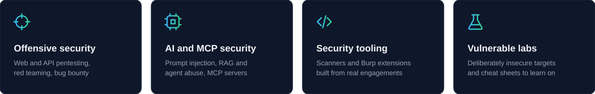

<p align="center">
  
</p>

<p align="center">
  <a href="https://linkedin.com/in/sonuoffsec"></a>&nbsp;
  <a href="https://medium.com/@sonuoffsec"></a>
</p>

I'm a **Lead Penetration Tester, red teamer and AppSec engineer**. I look for weaknesses so systems end up stronger, and I build the tools and deliberately vulnerable labs I wish I had when I was learning. Most of my recent work is about **securing AI, LLM, RAG and MCP systems**.

## What I work on

<p align="center">
  
</p>

## Latest

**[mcp-vet](https://github.com/sonuoffsec/mcp-vet)** is a free static security scanner for MCP servers (Python, JavaScript, TypeScript). It follows what a model passes into a tool to dangerous calls and reports command injection, path traversal, SSRF, SQL injection, hardcoded credentials and hidden instructions. It also checks the MCP servers configured in your own Claude Desktop, Cursor and VS Code.

```bash
uvx --from mcp-vet-scanner mcp-vet --clients
```

## Featured work

| Project | What it is |
|---|---|
| **[mcp-vet](https://github.com/sonuoffsec/mcp-vet)** | Static security scanner for MCP servers and client configs. Zero dependencies, SARIF output, GitHub Action. |
| **[DVAP](https://github.com/sonuoffsec/DVAP)** | OWASP-aligned intentionally vulnerable platform for learning and testing AI, LLM, RAG, MCP and agentic AI security. |
| **[AI-Security-Hub](https://github.com/sonuoffsec/AI-Security-Hub)** | Payloads, cheat sheets, labs, tools and CTFs for AI, LLM, RAG, MCP and agent security. |
| **[ThreatLens](https://github.com/sonuoffsec/ThreatLens)** | AI-powered Burp Suite extension for real-time vulnerability analysis. |
| **[actionhunter](https://github.com/sonuoffsec/actionhunter)** | CI/CD scanner for GitHub Actions supply-chain risks, unpinned dependencies and secret exposure. |
| **[atlas-benchmark](https://github.com/sonuoffsec/atlas-benchmark)** | Adversarial taxonomy for LLM attack surfaces: jailbreak primitives and severity scoring. |
| **[CleanTheTV](https://github.com/sonuoffsec/cleanthetv)** | Side project: one-command debloat, privacy DNS and a dark launcher with a guest Wi-Fi QR for Android TV. |

## Get in touch

Found a false positive in one of my scanners? Open an issue on the repository.
